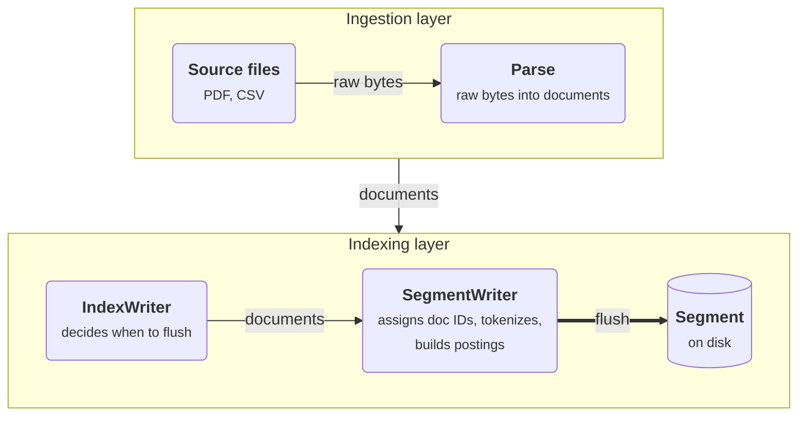
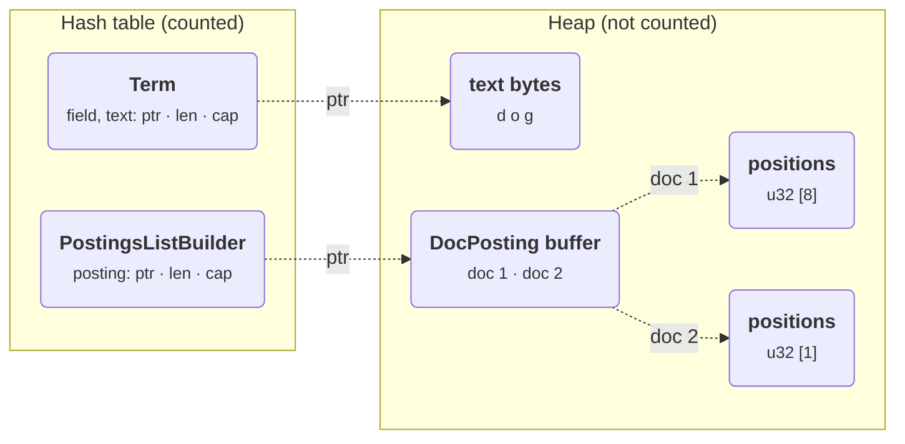

A couple of months ago, I started building [Seeq](https://github.com/ElijahAhianyo/seeq/), a small search engine in Rust which began purely out of curiosity because I wanted to solidify my understanding of information retrieval and learn how search engines work from first principles.

Along the way, I ran into an issue where I needed to accurately account for the amount of memory used while building the index. The idea is that Seeq builds part of the index in memory and then writes it to disk in chunks, so it needs a useful way to know when a chunk has grown large enough to flush.

To give some context, let's explore some background on the basic architecture of Seeq.

## Background: What is an inverted index?

For this discussion, we can think of a search engine as having two main parts: an inverted index and a query engine built on top of it to find and retrieve relevant documents.

To put it simply, an inverted index is a data structure that maps each term to a list of the documents that contain it, often along with the term's frequency and positions in each document. The query engine can use this information to rank the results. Some indexes also store additional information to help with scoring, but we won't need that here.

### A basic example

Let's walk through a small example to build a good mental model of how these pieces connect to produce the index. Say we want to build an inverted index from two documents:

```text
doc 1 -> "The quick brown fox jumps over the lazy dog."
doc 2 -> "The dog chased the quick fox."
```

The first thing to do is run the text through a pipeline that normalizes the case, so that searches are case insensitive. Then we tokenize it and record the position of each token, which is pretty useful for finding where a term occurs in a document. Here, positions count tokens from zero:

```text
doc 1: the(0) quick(1) brown(2) fox(3) jumps(4) over(5) the(6) lazy(7) dog(8)
doc 2: the(0) dog(1) chased(2) the(3) quick(4) fox(5)
```

Now, for every token, we record the document ID and the position where it appears. We essentially build a dictionary (a mapping) from each term to a list of postings. Each posting is a document entry that holds a document ID and the positions at which the term appears in that document.

The result looks something like this:

```text
term     posting list
-------  ------------------------------------
brown    doc 1: [2]
chased   doc 2: [2]
dog      doc 1: [8]      doc 2: [1]
fox      doc 1: [3]      doc 2: [5]
jumps    doc 1: [4]
lazy     doc 1: [7]
over     doc 1: [5]
quick    doc 1: [1]      doc 2: [4]
the      doc 1: [0, 6]   doc 2: [0, 3]
```

As you can see, the term "brown" appears once, in doc 1 at position 2. The term "dog" appears once in each document, at position 8 in doc 1 and position 1 in doc 2. The term "the" appears four times in total, twice in doc 1 at positions 0 and 6, and twice in doc 2 at positions 0 and 3.

## How Seeq builds an index

In Seeq, building an inverted index is a pipeline divided into two layers: the ingestion layer and the indexing layer.



The ingestion layer reads raw bytes from input sources such as PDFs and CSVs and parses them into documents that the indexing layer can process. Each document is then handed to the index writer.

The indexing layer starts at the index writer, which manages the lifecycle of the index. It hands each document to a segment writer. The segment writer assigns increasing document IDs within its segment, tokenizes the text and builds the postings mapping in memory. When it is flushed, it writes those postings to disk as a **segment**, which is a self-contained slice of the index.

One thing to note is that segments written to disk are immutable; once written, they can't be modified in place. After a flush, new documents are added to a new segment. On commit, Seeq flushes the remaining documents and performs a k-way merge, which walks through all the sorted segments at the same time and combines them into a single new segment.

Here are the relevant fields from the writers, with unrelated fields omitted:

```rust
pub struct IndexWriter {
    segment_writer: Option<SegmentWriter>,
    memory_budget_bytes: usize,
    flush_threshold_bytes: usize,
    // ...
}

pub struct SegmentWriter {
    postings: PostingsBuilder,
    max_doc: u32,
    store: Vec<StoreDoc>,
    // ...
}
```

## The first version: a tree and nested vectors

Originally, the builders looked like this. I've omitted derives and visibility details:

```rust
pub struct DocumentId(pub u32);
pub struct FieldId(pub u64);

pub struct PostingsBuilder {
    map: BTreeMap<Term, PostingsListBuilder>,
}

pub struct PostingsListBuilder {
    posting: Vec<DocPosting>,
}

pub struct DocPosting {
    doc_id: DocumentId,
    term_freq: u32,
    positions: Vec<u32>,
}

pub struct Term {
    field: FieldId,
    text: String,
}
```

The `BTreeMap` was convenient because terms need to be sorted when writing a segment, and you get that ordering for free when iterating over a B-tree. For each token, I found its posting list, updated the last posting if it belonged to the current document, or appended a new posting otherwise.

This was straightforward to build. However, we still need to know when the in-memory postings have grown large enough to flush to disk.

## Giving the writer a budget

Now, in order to keep memory usage under control, we give the writer a budget: a threshold at which it should flush the current segment to disk. So, for instance, if we set a budget of 64 MiB, the index writer flushes the segment when its reported usage reaches that amount.

```rust
// Inside IndexWriter, after adding a document:
if writer.memory_usage() >= self.memory_budget_bytes {
    self.flush_current_segment()?;
}
```

<SentenceNote note="A memory budget can be exposed as configuration. In Seeq's current implementation, `Index::writer()` sets these values:

```rust
let memory_budget_bytes = 64 * 1024 * 1024;
let headroom = 0.10;
```

">The budget is supplied by the index writer.</SentenceNote>

There's one issue, though. It's easy to overshoot the budget. Say the budget is 64 MiB, and the segment writer has used 63 MiB. If the next document adds 2 MiB of postings, it will have used 65 MiB, which is over the budget.

To reduce the chance of this happening, we can introduce a 10% headroom. Before adding another document, the index writer flushes the segment to disk if it has already used 90% of its budget. This helps tolerate overshoots such that we never cross the actual hard limit. 

```rust
let memory_budget_bytes = 64 * 1024 * 1024;
let headroom = 0.10;
let flush_threshold_bytes =
    memory_budget_bytes - (memory_budget_bytes as f64 * headroom) as usize;

// Inside IndexWriter; initialization details omitted.
pub fn add_document(&mut self, document: SourceDocument) -> Result<()> {
    if let Some(writer) = &self.segment_writer
        && writer.memory_usage() >= self.flush_threshold_bytes
    {
        self.flush_current_segment()?;
    }

    // Create a segment writer if needed.
    let writer = self.segment_writer.as_mut().unwrap();
    writer.add_document(&document)?;

    if writer.memory_usage() >= self.memory_budget_bytes {
        self.flush_current_segment()?;
    }
    Ok(())
}
```

<SentenceNote note="The checks run between documents. A large document can exceed the remaining budget while it is being indexed. The second check is a defensive check that flushes afterward in case we're past the limit after adding. Also notice that `SegmentWriter::memory_usage()` currently measures the postings builder, leaving the stored documents and temporary flush buffers outside that estimate.">We still check the full budget after adding a document, since headroom can't guarantee that every document will fit.</SentenceNote>

## Trying to count the allocations

Our `PostingsBuilder` contains a map of `Term` to `PostingsListBuilder`, which is a wrapper around a `Vec<DocPosting>`. Each `DocPosting` contains a `Vec<u32>` of positions.

Let's say we want to estimate the memory usage of the `PostingsBuilder`. We can start by summing the sizes of the structures and the heap-allocated buffers their fields own.

### Counting the vectors

In Rust, a vector stores its elements in a block of memory called a buffer, and to find the buffer's size in bytes, we need to multiply the vector's capacity (<SentenceNote note = "Note that this is different from the length, which is the current number of elements in use">the total number of elements the vec can hold</SentenceNote>) by the size of one element. For example, a vector with capacity of `10 u32` values needs `10 × 4 = 40 bytes`.

In addition to the buffer, the vector also saves a small fixed-size header containing metadata that it uses to keep track of where the buffer is, how much capacity it has, and how much of it is in use (length). To calculate the total memory usage, we need to add the header's size to that of the buffer:

```rust
use std::mem::size_of;

let positions: Vec<u32> = Vec::with_capacity(10);
let buffer_bytes = positions.capacity() * size_of::<u32>();
let total_bytes = size_of::<Vec<u32>>() + buffer_bytes;
```

Remember, `len()` tells us how many elements are in the vector, while `capacity()` tells us how many it can hold before reallocating. We need to count the spare capacity as well. The [Rust documentation](https://doc.rust-lang.org/std/vec/struct.Vec.html#guarantees) explains the distinction between the vector header and its buffer.

Applied to the original builders, an estimate would look like this:

```rust
let mut bytes = size_of::<PostingsBuilder>();

for (term, list) in &self.map {
    bytes += size_of::<Term>() + term.text.capacity();
    bytes += size_of::<PostingsListBuilder>();
    bytes += list.posting.capacity() * size_of::<DocPosting>();

    for posting in &list.posting {
        bytes += posting.positions.capacity() * size_of::<u32>();
    }
}
```

There are two problems here. First, every measurement walks all the terms and their document postings. We don't scan each position, but the work still grows with the index. Doing this around every document insertion would repeatedly revisit data we've already counted which can be very inefficient at scale.

Second, it remains incomplete. You see, unlike the `Vec`, `BTreeMap` doesn't expose the allocation size of its internal nodes or expose a public API to accurately obtain this, so those bytes are missing from our estimate. Its [public API](https://doc.rust-lang.org/std/collections/struct.BTreeMap.html) gives us an entry count, but there's no equivalent byte count.

### Would a hash map help?

The standard `HashMap` in `std` does provide a [`capacity`](https://doc.rust-lang.org/std/collections/struct.HashMap.html#method.capacity) method, but it only reports how many entries the map can hold without reallocating, and not how many bytes it has allocated. Multiplying that number by the size of a key-value pair will still not be accurate since it doesn't take into account the hidden allocations used by the map.

The good thing is that we can get a more useful number from the [`hashbrown`](https://github.com/rust-lang/hashbrown) crate, which is the implementation used by the standard library's hash map. It provides an [`allocation_size()` method](https://docs.rs/hashbrown/0.17.1/hashbrown/struct.HashMap.html#method.allocation_size) that reports the bytes allocated internally for the map.

We could replace the `BTreeMap` with `hashbrown::HashMap` and start with:

```rust
use hashbrown::HashMap;

let map: HashMap<Term, PostingsListBuilder> = HashMap::new();
let table_bytes = map.allocation_size();
```

It's worth noting that using a hash map would give us a better handle on the table's allocation, but we'd lose the sorted iteration we get with the B-tree. To be honest, this is absolutely fine, since we can sort the terms once at the end, when we're finally ready to write the segment to disk.

There's also another problem worth addressing. `Term` carries a heap-allocated `String`, and `PostingsListBuilder` carries a heap-allocated `Vec<DocPosting>`. The hash map stores their headers, which hold pointers, but the actual buffers are in different locations on the heap.



When you call `allocation_size` on the hash map, it doesn't follow those pointers and calculate the memory used by the buffers, which means you'd have to do that manually. Now getting a vector's capacity takes constant time, but summing the capacities across all our posting lists still requires a walk through every entry in the map and we really don't want to do that.

### Keeping a running count

To be fair, there are a couple of ways we can get a constant-time `memory_usage()` method. One approach is to keep a counter and update it whenever an allocation changes. For example, when a positions vector grows:

```rust
let before = positions.capacity();
positions.push(position);
let after = positions.capacity();

bytes_used += (after - before) * size_of::<u32>();
```

That kind of works, but we'd need to cover each string and vector allocation as well as the table itself.

Another option is to track allocations through a custom allocator. Rust provides the [`GlobalAlloc` trait](https://doc.rust-lang.org/std/alloc/trait.GlobalAlloc.html) for implementing a process-wide allocator, which could maintain an atomic counter. I didn't want to make the segment budget depend on a shared counter for the whole process. That counter would include every allocation in the program, not just the ones made by our writer, so we'd need more machinery to attribute memory to each segment writer, and if we parallelize indexing later, every thread updating the same atomic counter could slow things down. Each writer can keep its own counter; we don't need an atomic just because different writers might run on different threads.

### Moving allocations into an arena

The other option is to use a [memory arena](https://en.wikipedia.org/wiki/Region-based_memory_management). An arena hands out memory from larger blocks and typically reclaims those allocations together. It doesn't have to be one contiguous block or be fully allocated upfront; it can add blocks as it grows.

With the kind of arena we need here, individual buffers aren't freed as we go. We release them all when the segment writer has finished with them. That fits our indexing flow where we build the postings, write them to disk, then drop the builder.

The idea is that we control where allocations happen and keep a running count, so obtaining that count takes constant time. I got this idea from [Tantivy's memory arena](https://github.com/quickwit-oss/tantivy/blob/main/stacker/src/memory_arena.rs), which uses pages and compact addresses for its indexer. We'd still need to distinguish bytes handed out from whole blocks allocated, but we'd have a much clearer place to do that bookkeeping.

## Why not use an existing arena?

There are mature arenas, such as [Bumpalo](https://docs.rs/bumpalo/latest/bumpalo/), so my first instinct was to use one for this. [Bumpalo](https://docs.rs/bumpalo/latest/bumpalo/) is a [bump allocator](https://en.wikipedia.org/wiki/Region-based_memory_management) that grabs memory in large chunks and keeps a pointer that it moves along the chunk whenever an object is allocated in the arena (Bumpalo actually [bumps downward](https://fitzgeraldnick.com/2019/11/01/always-bump-downwards.html)). The way it works is that, it keeps a chunk of bytes, then when you allocate an object, it gives you a reference (a `&mut` ref) which you can use to mutate the object in place. A simple example looks like this:

```rust
use bumpalo::Bump;

fn main() {
    let bump = Bump::new();

    let a = bump.alloc(10u32);
    let b = bump.alloc(20u32);

    *a += 1;
    println!("a = {a}, b = {b}");
    println!("a at {:p}, b at {:p}", a, b);
}

```

Each `alloc` call only needs a shared reference to the arena (`&self`) and produces a `&mut` reference which points to a separate memory location, so it's safe to have multiple `&mut` references. That's the beauty of using `bumpalo`.

Now using `bumpalo` in our case meant we'll have something like this:

```rust
use bumpalo::{collections::Vec as BVec, Bump};
use std::collections::HashMap;
struct SegmentWriter<'a> {
    arena: Bump,
    map: HashMap<String, BVec<'a, u32>>,
}

impl<'a> SegmentWriter<'a> {
    fn new() -> Self { Self { arena: Bump::new(), map: HashMap::new() } }

    fn record(&mut self, term: &str, pos: u32) {
        let arena = &self.arena;
        self.map.entry(term.to_string())
            .or_insert_with(|| BVec::new_in(arena))
            .push(pos);
    }
}

```

In this case, we store the allocator per segment and use Bumpalo's Vec so we can insert `Vec` types into the arena. The `Vec` also carries a lifetime since its lifetime needs to be tied to an arena so this means the `SegmentWriter` struct needs to carry a lifetime.

Now if you run this, you get this error:

```
error: lifetime may not live long enough
  --> src/main.rs:14:32
   |
 8 | impl<'a> SegmentWriter<'a> {
   |      -- lifetime `'a` defined here
...
11 |     fn record(&mut self, term: &str, pos: u32) {
   |               - let's call the lifetime of this reference `'1`
...
14 |             .or_insert_with(|| BVec::new_in(arena))
   |                                ^^^^^^^^^^^^^^^^^^^ method was supposed to return data with lifetime `'a` but it is returning data with lifetime `'1`
```

The issue is because the `'a` lifetime suggests it is set by whoever creates the `SegmentWriter` but when `record` is called, the Vec's lifetime is supplied by `self.arena` which lives in the same struct. This is self referential and Rust cannot express this.

Now you may be wondering, we can allow the caller to create the arena and pass a reference to the `SegmentWriter`, so the `SegmentWriter` now holds an `&'a Bump` instead of owning it:

```rust
struct IndexWriter<'a> {
    arena: Bump,
    segment_writer: Option<SegmentWriter<'a>>,
}
impl<'a> IndexWriter<'a> {
    fn new() -> Self { Self { arena: Bump::new(), segment_writer: None } }
    fn add_document(&mut self) {
        if self.segment_writer.is_none() {
            self.segment_writer = Some(SegmentWriter::new(&self.arena));
        }
    }
}

```

Well, as you may have guessed, this also throws the same error for the same reason:

```
error: lifetime may not live long enough
 --> src/main.rs:9:13
  |
5 | impl<'a> IndexWriter<'a> {
  |      -- lifetime `'a` defined here
6 |     fn new() -> Self { Self { arena: Bump::new(), segment_writer: None } }
7 |     fn add_document(&mut self) {
  |                     - let's call the lifetime of this reference `'1`
8 |         if self.segment_writer.is_none() {
9 |             self.segment_writer = Some(SegmentWriter::new(&self.arena));
  |             ^^^^^^^^^^^^^^^^^^^ assignment requires that `'1` must outlive `'a`
```


We could push the arena even further up so the user creates it:

```rust
use bumpalo::{collections::Vec as BVec, Bump};
use std::collections::HashMap;

struct SegmentWriter<'a> {
    arena: &'a Bump,
    map: HashMap<String, BVec<'a, u32>>,
    max_doc: u32,
}
impl<'a> SegmentWriter<'a> {
    fn new(arena: &'a Bump) -> Self { Self { arena, map: HashMap::new(), max_doc: 0 } }
    fn add_document(&mut self, words: &[&str]) {
        let arena = self.arena;
        for (pos, w) in words.iter().enumerate() {
            self.map.entry(w.to_string()).or_insert_with(|| BVec::new_in(arena)).push(pos as u32);
        }
        self.max_doc += 1;
    }
    fn memory_usage(&self) -> usize { self.arena.allocated_bytes() }
}

struct IndexWriter<'a> {
    arena: &'a Bump,
    segment_writer: Option<SegmentWriter<'a>>,
    threshold: usize,
}
impl<'a> IndexWriter<'a> {
    fn new(arena: &'a Bump, threshold: usize) -> Self {
        Self { arena, segment_writer: None, threshold }
    }
    fn add_document(&mut self, words: &[&str]) {
        let arena = self.arena;
        let w = self.segment_writer.get_or_insert_with(|| SegmentWriter::new(arena));
        w.add_document(words);
        let usage = w.memory_usage();
        println!("usage = {usage}");
        if usage >= self.threshold { self.flush(); }
    }
    fn flush(&mut self) {
        if let Some(w) = self.segment_writer.take() { println!("flush: {} docs", w.max_doc); }
    }
}

fn main() {
    let bump = Bump::new();
    let mut iw = IndexWriter::new(&bump, 1000);
    for _ in 0..6 {
        iw.add_document(&["the","quick","brown","fox","jumps","over","the","lazy","dog"]);
    }
}
```

Now this creates a leaky abstraction. Users should never really know about the arena, and they shouldn't have any control over it. Very bad design.

There's also a bigger problem hiding in there. Since the same `Bump` is shared by every segment writer and never reset, `allocated_bytes()` keeps climbing even after we flush, so once we cross the threshold, every new document triggers another flush. We can't reset the arena either, since `reset` needs a `&mut Bump` while the segment writers still hold shared references to it.

We could also try to use crates like [ouroboros](https://docs.rs/ouroboros) or [self_cell](https://docs.rs/self_cell) which can help with the self-referential lifetime issues, but they come with their own flaws which I won't be exploring in this article.

To make this work, we're left with the option of rolling our own ad hoc arena to address these issues.

## A basic arena

The main pain point with getting Bumpalo to work was having to wrestle with lifetimes. But really, what if we didn't really need actual references? Like most computing problems, we can introduce an indirection. Rather than returning a reference which we will need to deal with, we can return some kind of [Handle](https://en.wikipedia.org/wiki/Handle_%28computing%29) which is an offset from the start of the arena. This could be a plain integer (`u32`), which is much easier to deal with and pass around since it implements `Copy`. A naive version of our arena can look like this:


```rust
#[derive(Clone, Copy, Debug)]
struct Addr(u32);

struct Arena { data: Vec<u8> }

impl Arena {
    fn new() -> Self { Self { data: Vec::new() } }

    fn allocate(&mut self, n: usize) -> Addr {
        let start = self.data.len();
        self.data.resize(start + n, 0);   // reserve n more bytes at the end
        Addr(start as u32)                // handle = where they begin
    }
    fn write_u32(&mut self, addr: Addr, v: u32) {
        let s = addr.0 as usize;
        self.data[s..s + 4].copy_from_slice(&v.to_le_bytes());
    }
    fn read_u32(&self, addr: Addr) -> u32 {
        let s = addr.0 as usize;
        u32::from_le_bytes(self.data[s..s + 4].try_into().unwrap())
    }
}
```

Over here, our `Arena` is just a thin wrapper around a `Vec` of bytes. We expose `write_u32` and `read_u32` which helps us read and write `u32`s which are 4 bytes in size. You can see that we return the position where the reserved bytes start, wrapped in a Handle: `Addr` which the user stores or passes around and in turn provides to access a location in the arena.

Now one issue with using a `Vec` here happens when there's a need to resize it.
You see, when the `Vec` reaches its capacity, it is copied over into a new location typically twice its size to accommodate more objects (Rust doesn't guarantee the exact growth factor). The issue is that during the copy of the items, the old buffer and the new buffer exist simultaneously which leaves a huge memory footprint and can be problematic. Imagine the case where an arena holds `520 MiB` of data in memory, resizing this means you easily have `1 GiB` + `520 MiB` (during copy) in memory. This can easily run us out of memory and crash the process with an OOM (out of memory) error.

It's worth noting that our handles would still be fine here, since they are offsets from the start of the buffer and stay valid even when the buffer moves, which is something references can't do. The only problem is the memory spike during the copy.

## Pages and addresses

To resolve this, we can introduce another indirection where we create fixed blocks or pages of memory. Since these are fixed in size, there's no need for resizing. We only add more pages or blocks when needed.

```rust
const PAGE_SIZE: usize = 1 << 20; // 1 MiB

#[derive(Debug, Clone, Copy, PartialEq, Eq)]
pub struct Addr(u32);

impl Addr {
    pub fn new(page_id: usize, page_offset: usize) -> Self {
        assert!(page_offset < PAGE_SIZE);
        Self((page_id * PAGE_SIZE + page_offset) as u32)
    }

    pub fn page_id(&self) -> usize {
        self.0 as usize / PAGE_SIZE
    }

    pub fn page_offset(&self) -> usize {
        self.0 as usize % PAGE_SIZE
    }
}

impl Add<usize> for Addr {
    type Output = Addr;
    fn add(self, other: usize) -> Self::Output {
        Self((self.0 as usize + other) as u32)
    }
}

impl Add<u32> for Addr {
    type Output = Addr;
    fn add(self, other: u32) -> Self::Output {
        Self(self.0 + other)
    }
}

#[derive(Debug, Clone)]
pub struct Page {
    data: Box<[u8; PAGE_SIZE]>,
    len: usize,
}

impl Page {
    pub fn new() -> Self {
        Self {
            data: Box::new([0; PAGE_SIZE]),
            len: 0,
        }
    }

    pub fn remaining(&self) -> usize {
        PAGE_SIZE - self.len
    }
}

pub struct MemoryArena {
    pages: Vec<Page>,
    bytes_used: usize,
}

```
Over here, we choose to keep fixed page slices of 1 MiB, which is the same page size Tantivy uses. Our `Addr` struct also gains a few methods. Now an `Addr` helps us find the exact page number containing the data and the offset from the start of the page relative to the exact first byte of the data. Locating the page can be calculated by dividing the address by the page size which is pretty neat since integer division discards the remainder and rounds down. We can also obtain the offset from the address by finding the modulo between the address and the page size. To find the data, we obtain the page id from the address, access the page and then access the data by obtaining the offset.  You may realize that this resembles how virtual memory addressing works, where an address is split into a page number and an offset.

For example, `Addr(1_048_592)` means page 1, offset 16, since 1,048,592 is one full page (1,048,576 bytes) plus 16 bytes. It's worth noting that since the address is a `u32`, it can only cover 4 GiB in total, and the `as u32` cast would silently wrap past that. That's comfortably above our 64 MiB budget, but a general purpose version would need an explicit overflow check.

## Building the arena

Now that we have the page and addressing logic in place, we can go ahead and flesh out the logic for the Arena. The arena is the clear entrypoint to store and manage data(or bytes) in the pages, so we'll need to provide some useful methods to do that:

```rust
pub struct MemoryArena {
    pages: Vec<Page>,
    bytes_used: usize,
}

impl MemoryArena {
    pub fn new() -> Self {
        Self {
            pages: Vec::new(),
            bytes_used: 0,
        }
    }

    pub fn memory_usage(&self) -> usize {
        self.bytes_used
    }

    pub fn allocate(&mut self, num_bytes: usize) -> Addr {
        assert!(
            num_bytes <= PAGE_SIZE,
            "Arena allocation cannot be larger than {PAGE_SIZE}. Got {num_bytes}."
        );

        if self.pages.last().is_none_or(|p| p.remaining() < num_bytes) {
            self.pages.push(Page::new());
        }

        let page_id = self.pages.len() - 1;
        let page = &mut self.pages[page_id];
        let offset = page.len;
        page.len += num_bytes;
        self.bytes_used += num_bytes;

        Addr::new(page_id, offset)
    }

    pub fn write_bytes(&mut self, addr: Addr, bytes: &[u8]) {
        let page = &mut self.pages[addr.page_id()];
        let start = addr.page_offset();
        page.data[start..start + bytes.len()].copy_from_slice(bytes);
    }

    pub fn read_bytes(&self, addr: Addr, len: usize) -> &[u8] {
        let page = &self.pages[addr.page_id()];
        let start = addr.page_offset();
        &page.data[start..start + len]
    }

    pub fn write_u32(&mut self, addr: Addr, index: usize, value: u32) {
        self.write_bytes(addr + index * 4, &value.to_le_bytes())
    }

    pub fn read_u32(&self, addr: Addr, index: usize) -> u32 {
        u32::from_le_bytes(self.read_bytes(addr + index * 4, 4).try_into().unwrap())
    }
}

```

The `allocate` method is really of value here. The idea is that, when you want to store data in the arena, you need to pre-allocate or reserve the amount of memory you need and then you get an address to that memory slice in return. When you call this method, a slice is reserved in the last page, or in a new page if the last one doesn't have enough room left. We also provide some useful methods to read and write bytes into the arena. Here, we restricted them to `u32` for now since the position data we will store in the arena are `u32`s. We also provide a `memory_usage` method where we can return the accumulated memory we use at every point in time.

It's worth noting that `memory_usage` counts the bytes we hand out rather than the pages we allocate. So the very first 16 byte allocation reports 16 bytes even though a whole 1 MiB page now exists, and the unused space left at the end of each page isn't counted either. For a budget, `pages.len() * PAGE_SIZE` would be the more conservative number, which is what Tantivy reports in its [`mem_usage()`](https://github.com/quickwit-oss/tantivy/blob/main/stacker/src/memory_arena.rs), but in practice the difference is small next to a 64 MiB budget.

While we are here, we can also add a custom `ArenaVec32` that allows us to store multiple `u32`s as a collection:


```rust

#[derive(Debug, Clone, Copy, Default)]
pub struct ArenaVec32 {
    addr: Option<Addr>,
    len: usize,
    cap: usize,
}

impl ArenaVec32 {
    /// Push a new u32 into the Vec
    pub fn push(&mut self, arena: &mut MemoryArena, value: u32) {
        if self.len == self.cap {
            self.grow(arena)
        }
        arena.write_u32(self.addr.unwrap(), self.len, value);
        self.len += 1;
    }

    /// Grow the capacity of the vec to a new size when full.
    pub fn grow(&mut self, arena: &mut MemoryArena) {
        let new_cap = if self.cap == 0 { 4 } else { self.cap * 2 };
        // allocate takes bytes, so we multiply the capacity by the size of a u32
        let new_addr = arena.allocate(new_cap * size_of::<u32>());
        if let Some(old_addr) = self.addr {
            for i in 0..self.len {
                arena.write_u32(new_addr, i, arena.read_u32(old_addr, i))
            }
        }

        self.addr = Some(new_addr);
        self.cap = new_cap;
    }

    /// Converts the ArenaVec into a Vec
    pub fn to_vec(&self, arena: &MemoryArena) -> Vec<u32> {
        (0..self.len)
            .map(|i| arena.read_u32(self.addr.unwrap(), i))
            .collect()
    }
}

```

The logic here is quite simple and similar to how `Vec`s fundamentally work; the `push` method allows us to append to the `ArenaVec`, and we implicitly <SentenceNote note="If you look at the original pull request, you'll notice that I passed `new_cap` directly to `allocate`, which reserved 4 bytes for four integers that needed 16. I've since fixed it by multiplying by the size of a `u32`, since the capacity counts elements while the arena counts bytes.">grow the vec</SentenceNote> by copying the existing data to another location with adequate space once we hit the capacity.

One thing to note is that, unlike a regular `Vec`, our `ArenaVec32` can't free the old slice when it grows, since the arena only hands out memory and never takes it back. Say we push five positions into an empty `ArenaVec32`. The first push allocates 16 bytes (room for four `u32`s), and the fifth push allocates 32 bytes for eight and copies the first four over, which leaves the old 16 bytes abandoned in the page. The arena now reports 48 bytes even though we only store 20 bytes worth of positions. These abandoned slices stay around until the whole arena is dropped, which is fine for us since we drop it after every flush anyway.

There's also a size limit, since a single allocation can't be larger than a page. One list can grow to at most 262,144 positions, and its next growth would panic. That's plenty for the positions of a term within a single document, but it's worth keeping in mind.


## Plugging in the arena

Now we are in a good position to plug our ad hoc arena into our postings logic.

```rust
use hashbrown::{HashMap, hash_map::Entry};

#[derive(Debug, Clone, Default)]
pub struct DocPostingBuilder {
    doc_id: DocumentId,
    term_freq: u32,
    positions: ArenaVec32,
}

#[derive(Debug, Clone, Default)]
pub struct DocPosting {
    pub doc_id: DocumentId,
    pub term_freq: u32,
    pub positions: Vec<u32>,
}

#[derive(Debug, Clone, Default)]
pub struct PostingsListBuilder {
    pub(crate) posting: Vec<DocPostingBuilder>,
}

pub struct PostingsBuilder {
    map: HashMap<Term, PostingsListBuilder>,
    arena: MemoryArena,
    extra_mem_used: usize,
}

```

The `positions` field in `DocPostingBuilder` gets updated to an `ArenaVec32`, which means the position buffers now live in the arena instead of the regular heap. We also add an `arena: MemoryArena` field to the `PostingsBuilder` which owns all those buffers and keeps a running count of their bytes, so we can read it in constant time. We also add an `extra_mem_used` field which we keep to account for memory data that is not stored in the arena, like the text of the `Term` which we will talk about shortly in the next couple of sections.

You'll also notice that I swapped the `BTreeMap` for hashbrown's `HashMap`, which gives us `allocation_size()` to count the table itself. That covers the `Term` and `PostingsListBuilder` structs stored in its slots, along with its spare capacity and control bytes. Since we lose the sorted order we had with the `BTreeMap`, we sort the terms once when we're ready to write the segment to disk.


```rust

impl PostingsBuilder {
    pub fn new() -> Self {
        Self {
            map: HashMap::new(),
            arena: MemoryArena::new(),
            extra_mem_used: 0,
        }
    }

    pub fn record(&mut self, term: Term, doc_id: DocumentId, position: u32) {
        match self.map.entry(term) {
            Entry::Vacant(v) => {
                self.extra_mem_used += v.key().text.capacity();
                let mut dp = DocPostingBuilder {
                    doc_id,
                    term_freq: 1,
                    positions: ArenaVec32::default(),
                };
                dp.positions.push(&mut self.arena, position);
                self.extra_mem_used += size_of::<DocPostingBuilder>();
                v.insert(PostingsListBuilder { posting: vec![dp] });
            }
            Entry::Occupied(mut o) => {
                let entry = o.get_mut();
                match entry.posting.last_mut() {
                    Some(dp) if dp.doc_id == doc_id => {
                        dp.term_freq += 1;
                        dp.positions.push(&mut self.arena, position);
                    }
                    _ => {
                        let cap_before = entry.posting.capacity();
                        let mut dp = DocPostingBuilder {
                            doc_id,
                            term_freq: 1,
                            positions: ArenaVec32::default(),
                        };
                        dp.positions.push(&mut self.arena, position);
                        entry.posting.push(dp);
                        if entry.posting.capacity() > cap_before {
                            self.extra_mem_used += (entry.posting.capacity() - cap_before)
                                * size_of::<DocPostingBuilder>();
                        }
                    }
                }
            }
        }
    }

    pub fn memory_usage(&self) -> usize {
        self.arena.memory_usage() + self.map.allocation_size() + self.extra_mem_used
    }
}
```

The `record` method is what the `SegmentWriter` calls for every token it indexes, passing in the term, the document ID and the position of that token. I won't walk through every line of it here, since the part that really matters for this article is how it splits the memory accounting between the arena, the hash map and `extra_mem_used`.

Whenever we save a position, it goes through the `ArenaVec32` into the arena, and the arena counts those bytes on its own, so we never have to track them by hand. The `Term` and its `PostingsListBuilder` sit inside the hash map's slots, so `allocation_size()` already covers them. What the map doesn't cover are the buffers they point to, which are the bytes of the term's text and the buffer of `DocPostingBuilder`s behind each posting list, so we work out their size right before inserting them and add that to `extra_mem_used`. When the posting list's outer `Vec` grows, we compare its capacity before and after the push and only add the difference, which is the same running count idea we explored earlier.

You'll notice that we are still counting a handful of headers even though the positions now live in the arena. To be honest, there's no getting around that. Every container we keep outside the arena, whether it's the `String` in the term, the outer `Vec` of postings or the `ArenaVec32` itself, carries a small fixed-size header that has to live somewhere, and since those headers sit inline in the hash map or in the outer vector, they never pass through the arena's counter. The good thing is that `allocation_size()` already covers the headers sitting in the hash map, and the rest are fixed sizes we know at compile time through `size_of`, so counting them takes constant time and doesn't require us to walk anything.

Putting it all together, `memory_usage` becomes a simple sum of the arena's counter, the map's `allocation_size()` and `extra_mem_used`. hashbrown works out `allocation_size()` from the number of buckets in the table, and we update the other two as we go, so reading it takes constant time no matter how large the index grows.

## Why the Term isn't in the arena (yet)

You may have noticed that the `Term` text is the one piece of data that still lives on the heap as an owned `String`, even though we keep a copy of it for every distinct term in the segment. It's still accounted for in `extra_mem_used`, so our budget doesn't miss it, but it would be nice to move it into the arena alongside the positions. The natural way to do this would be to copy the bytes of the term into the arena and replace the `Term` key with something like this.

```rust
struct ArenaTerm {
    field: FieldId,
    len: u32,
    addr: Addr,
}
```

Now this is where things get tricky. A `HashMap` relies on the `Hash` and `Eq` implementations of its keys to decide which bucket a key lands in and whether two keys are the same. If we derive those traits for `ArenaTerm`, the map would hash and compare the field, the length and the address, rather than the actual text sitting in the arena. You see, two occurrences of "fox" would be copied to two different addresses, which means the map would treat them as two different keys and we'd end up with duplicate posting lists for the same term.

You might be thinking that we can just write our own `Hash` and `Eq` implementations that read the text from the arena. The problem is that [`Hash::hash`](https://doc.rust-lang.org/std/hash/trait.Hash.html#tymethod.hash) only receives the key through `&self` and a hasher, and [`eq`](https://doc.rust-lang.org/std/cmp/trait.PartialEq.html#tymethod.eq) only receives the two keys, so neither of them has any way of reaching the arena. Swapping out the map's `BuildHasher` doesn't help either, since it only hashes whatever the key hands it. The most direct way to give the key access to the arena would be to store a reference to the arena inside every key, and that brings us right back to the lifetime and self-referential issues we ran into with Bumpalo. There's also the lookup itself to think about, since every incoming token arrives as a regular `String`, and we'd need to compare it against bytes stored in the arena without copying it into the arena first.

What we really need is a hash map that knows about the arena. When a token comes in, it would hash the field and the text directly, [probe](https://en.wikipedia.org/wiki/Linear_probing) the table for a matching slot, and then compare the text by reading the stored bytes through their address and length. If there's no match, it copies the text into the arena and saves the new address in the table. This is how the more mature engines handle it.

It's worth mentioning that hashbrown, which we're already using for `allocation_size()`, also provides a lower level [`HashTable`](https://docs.rs/hashbrown/latest/hashbrown/struct.HashTable.html) which lets you pass in the hash and the equality check yourself as closures, and those closures can borrow the arena.

Building that kind of map is a big enough topic on its own, so I'll cover it in a separate article where we build an ad hoc hash map for Seeq and finally move the terms into the arena with it. For now, the `Term` stays on the heap and we keep counting it through `extra_mem_used`.

## Conclusion

We started out with a simple goal, which was to know when a segment has grown large enough to flush to disk. Counting the allocations by hand meant walking the entire postings map on every check, and even then, the B-tree and hash map hid some of their memory from us. Bumpalo looked like a good fit at first, but it pulled us into a fight with lifetimes that leaked the arena into the rest of the API. Rolling our own arena with pages and `u32` addresses got us out of that, since handles are plain integers that we can copy around without borrowing anything, and fixed-size pages mean the arena never has to copy itself over when it grows.

With the positions now living in the arena, the table counted through `allocation_size()` and the remaining heap buffers tracked through `extra_mem_used`, the segment writer can report its memory usage in constant time, which is exactly what the index writer needs to decide when to flush. It's worth noting that this is still an estimate rather than an exact measurement. The arena counts the bytes it hands out rather than the full pages it allocates, abandoned `ArenaVec32` buffers stay around until the segment is dropped, and none of these numbers include the allocator's own bookkeeping. Even so, we now have one place that most of the postings memory goes through, which makes it much easier to tighten the accounting as Seeq grows.

The next step is to move the terms into the arena as well, which means building a hash map that knows how to read its keys from the arena. I'll cover that in a future article. Until then, you can find the initial implementation in [this pull request](https://github.com/ElijahAhianyo/seeq/pull/1/).
